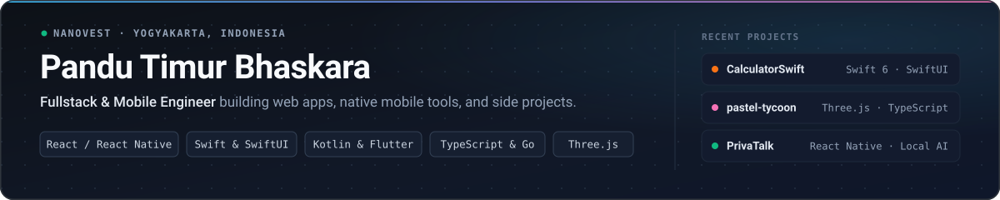
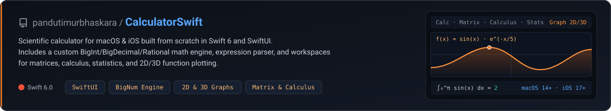
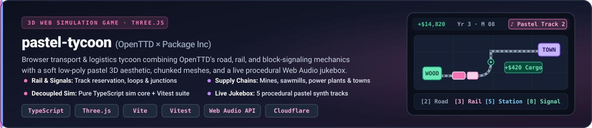
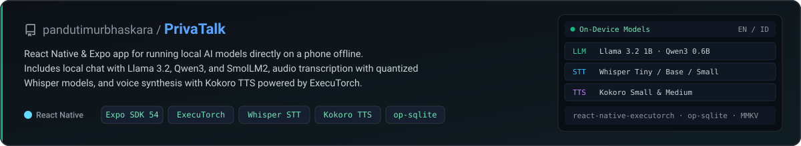

  

Hi, I'm **Pandu**. I'm a fullstack and mobile engineer at **Nanovest**, based in Yogyakarta.

Most of my day-to-day work is in **TypeScript**, **React**, **React Native**, **Flutter**, **Go**, and **Kotlin/Java**. Outside of work, I spend time building native macOS/iOS apps in Swift, small 3D web games, and mobile tools that run local AI models on-device.

**Links:** [LinkedIn](https://www.linkedin.com/in/pandu-timur-b-2aaa6712b/) · [timurpandu@gmail.com](mailto:timurpandu@gmail.com)

---

### Highlighted Projects

  

**[CalculatorSwift](https://github.com/pandutimurbhaskara/CalculatorSwift)** — Native scientific and graphing calculator for macOS and iOS written in Swift 6 and SwiftUI. Built with a custom arbitrary-precision number library (`BigInt`, `BigDecimal`, `Rational`), expression lexer/parser, and separate tabs for matrices, calculus, statistics, and 2D/3D plots.

 

  

**[pastel-tycoon](https://github.com/pandutimurbhaskara/pastel-tycoon)** — Browser transport game inspired by *OpenTTD* and *Package Inc*, built with TypeScript, Three.js, and Vite. Supports road and rail networks, one-way block signals, multi-stop cargo schedules, a unit-tested simulation core (`Vitest`), and a procedural Web Audio synth jukebox.

 

  

**[PrivaTalk](https://github.com/pandutimurbhaskara/PrivaTalk)** — React Native (Expo) app for running AI models locally on a phone without an internet connection. Uses `react-native-executorch`, `op-sqlite`, and `MMKV` to run local LLM chat (`Llama 3.2`, `Qwen3`, `SmolLM2`), speech-to-text (`Whisper`), and text-to-speech (`Kokoro`).

---

### Other Repositories

- **[VaultNote](https://github.com/pandutimurbhaskara/VaultNote)** — Markdown note and expense app in React Native with local LLM, STT, and image detection.
- **[BrainBooster](https://github.com/pandutimurbhaskara/BrainBooster)** — Math memory and puzzle game built with React Native Reanimated.
- **[saas-turborepo-template](https://github.com/pandutimurbhaskara/saas-turborepo-template)** — Turborepo + Next.js monorepo starter for multi-subdomain apps with shared auth and UI packages.
- **[compose-media-editor](https://github.com/pandutimurbhaskara/compose-media-editor)** — Android media editor written in Kotlin and Jetpack Compose.
- **[invitasi](https://github.com/pandutimurbhaskara/invitasi)** / **[invitasi-web](https://github.com/pandutimurbhaskara/invitasi-web)** — Digital invitation service built with a Go backend and TypeScript frontend.
